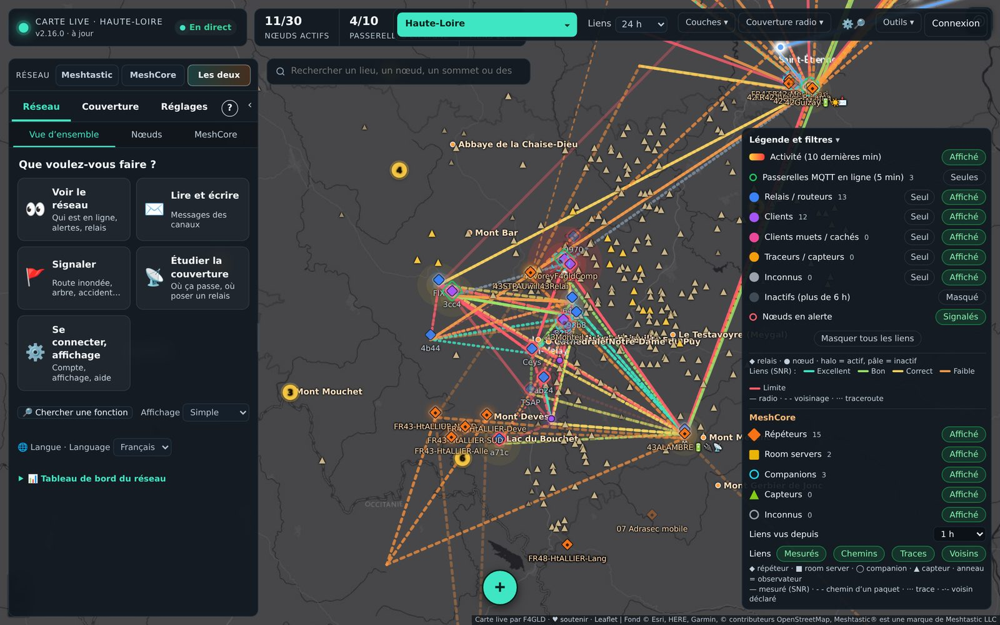
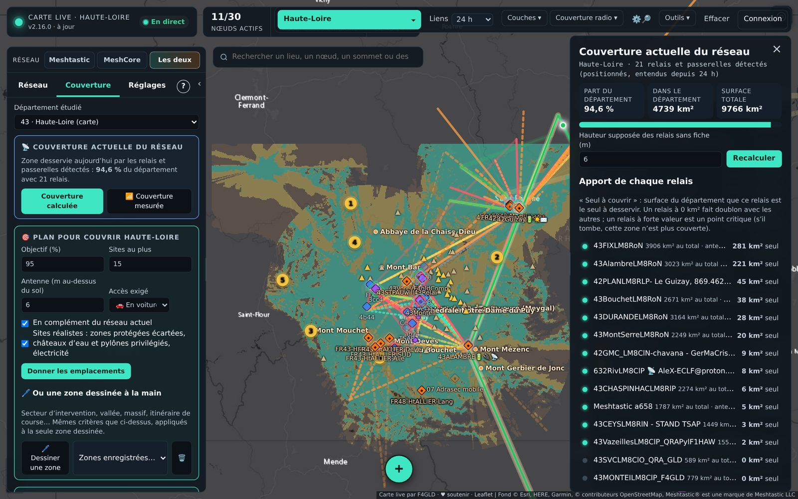
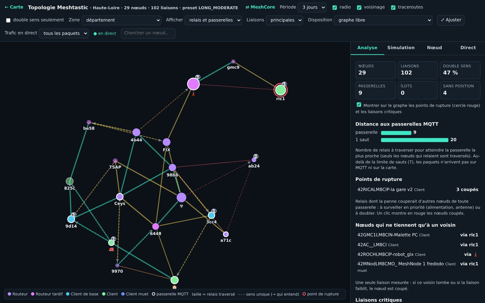
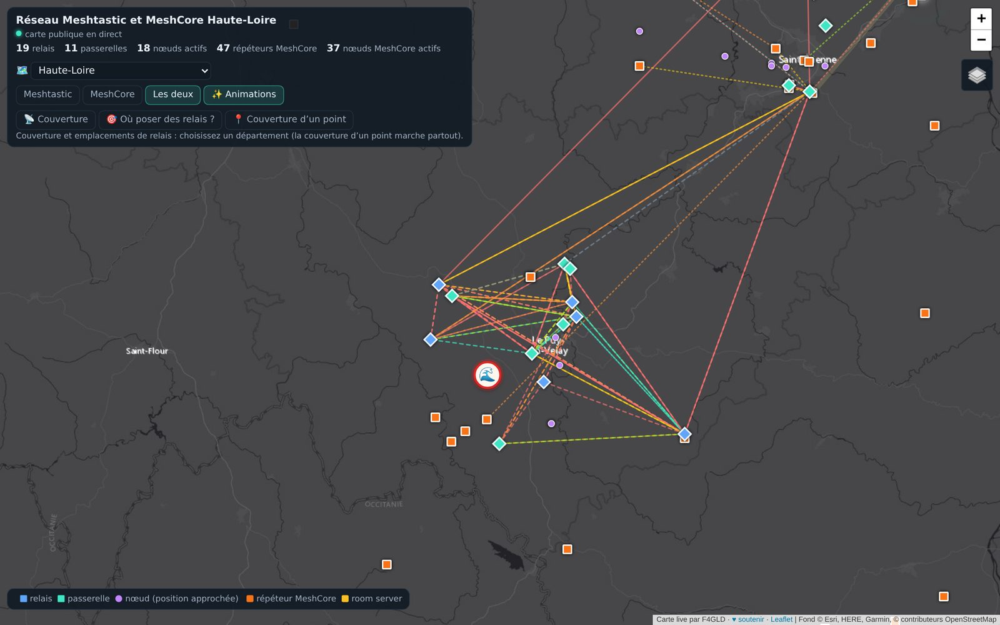
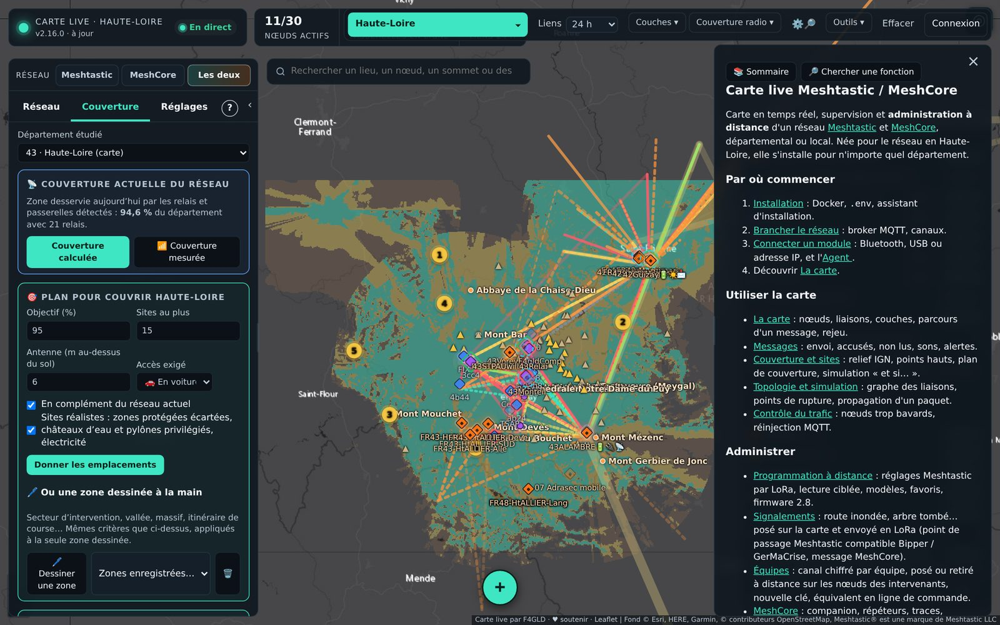

# Carte live Meshtastic

[](https://github.com/sauveteur71/carte-live-meshtastic/releases/latest)

**Version actuelle : 2.22.0** — [nouveautés](https://github.com/sauveteur71/carte-live-meshtastic/releases/latest) · [toutes les versions](https://github.com/sauveteur71/carte-live-meshtastic/releases)

Carte en temps réel, supervision et **administration à distance** d'un réseau [Meshtastic](https://meshtastic.org) — et désormais [MeshCore](https://meshcore.co.uk) — local ou départemental : elle écoute votre broker MQTT et/ou un module radio, décode les paquets, garde l'historique et permet de programmer vos nœuds par LoRa.

Né pour le réseau **Gaulix** en Haute-Loire (43), le programme s'installe pour n'importe quel département : tout se règle depuis l'assistant d'installation.

📖 **Documentation complète : [le wiki](https://github.com/sauveteur71/carte-live-meshtastic/wiki)** (sources dans le dossier [`wiki/`](wiki/)).

> 🇬🇧 *English summary at the end of this page.*



| Couverture calculée sur le relief | Graphe des liaisons |
|---|---|
|  |  |
| **Carte publique** | **Aide intégrée** |
|  |  |

---


**Installation en une commande** (Linux) : `curl -fsSL https://raw.githubusercontent.com/sauveteur71/carte-live-meshtastic/main/install.sh | sudo sh`, puis tout se règle dans la carte (voir le wiki, page Installation).
## Ce qu'il fait

**Carte et supervision**
- Nœuds en direct (relais, clients, passerelles MQTT…), légende et filtres façon MeshCore, couches IGN (plan, photos, relief ombré, toponymes) ou OpenStreetMap
- Liaisons radio mesurées (SNR, voisinage, traceroutes), trajets GPS, télémétrie (batterie, tension, occupation du canal…)
- Secteur affiché au choix : votre département, le département et ses voisins (calculés automatiquement d'après le département choisi à l'installation), ou toute la France
- Paquets animés en direct : une comète parcourt le trajet saut par saut (émetteur → relais → récepteur), une par récepteur ; les liaisons empruntées s'allument et les axes les plus utilisés depuis 10 min sont soulignés. Pour Meshtastic, quand les relais intermédiaires ne sont pas connus, le trajet le plus probable est déduit des liaisons observées (tracé en pointillé)
- Fiche détaillée de chaque nœud : informations, télémétries, voisins (« entendu par »), configuration déduite, toutes les trames avec filtres
- Alertes : nœud muet, batterie faible, canal saturé, passerelle hors ligne…
- **Liaisons à sens unique** : « B entend A mais A n'entend jamais B », liaisons très déséquilibrées et nœuds que personne n'entend
- **Chemins mesurés** : traceroutes automatiques (nœuds clés, la nuit si souhaité), chemin aller/retour avec le SNR de chaque saut, route changée
- **Couverture mesurée** : d'où les nœuds sont réellement reçus (positions + réceptions des passerelles), relevés de terrain avec un module mobile, recalage du modèle de relief
- **Maintenance** (onglet *Statistiques*) : charge radio des relais (temps d'émission, occupation du canal, tendance et alerte avant la limite de 10 %), autonomie (« tiendrait X jours sans soleil », relais qui ne se recharge plus), firmwares (version de chaque relais face à la dernière version stable), conseils de rôles (routeurs redondants ou mal placés, clients bien placés, rôles obsolètes)
- **Historique sur plus d'un an** (onglet *Statistiques*) : nœuds actifs, passerelles, trafic, occupation du canal, couverture calculée ; compactage automatique de la base
- **Santé de la carte** (onglet *Réseau*) : processeur, mémoire, réactivité, disque, base, MQTT, avec alertes
- **Sauvegarde automatique des réglages** chaque nuit (comptes, fiches, configurations, mots de passe MeshCore), téléchargeable et restaurable (*Connexion › Sauvegardes*)
- **Fiche d'installation des relais** : antenne, hauteur, gain, câble, puissance, alimentation, site ; utilisée par les calculs de couverture
- Analyse du trafic, rejeu de l'historique, profils radio entre deux points quelconques
- **Topologie et simulation** (*Outils › Topologie et simulation*) : graphe des liaisons mesurées (libre ou géographique), points de rupture et liaisons critiques (ce qui serait coupé de toute passerelle), relais les plus traversés, distance aux passerelles face à la limite de sauts, îlots, nœuds sans position ; **simulation de la propagation d'un paquet** d'après la logique du firmware 2.7 (attente selon le SNR, priorité des ROUTER, annulation par les CLIENT, ROUTER_LATE, sauts gratuits entre favoris, écoute du canal, collisions), animée ou sur 200 tirages, pour comparer preset, limite de sauts, favoris et rôles ; **trafic en direct** animé sur le graphe (comète émetteur → relais → passerelle, axes les plus empruntés, flux des derniers paquets)

**Relief et sites** (onglet *Couverture* et menu *Couverture radio*)
- **Couverture actuelle du réseau** : zone desservie par les relais et passerelles détectés, part du département, et ce que chaque relais est seul à couvrir (doublons, points critiques)
- **Simulation « et si… »** : retirer ou ajouter des relais (ou « et si ce relais tombait en panne ? » depuis sa fiche) → couverture avant/après, zones perdues ou gagnées, villes qui ne seraient plus couvertes, nombre de relais traversés entre les principales villes
- **N'importe quel département** : l'onglet Sites permet d'étudier un autre département que celui de la carte (relief IGN, points hauts, accès, plan de couverture) — par exemple savoir où poser des relais pour couvrir le Doubs depuis une carte installée en Haute-Loire
- **Plan pour couvrir le département** : objectif (%), nombre maximal de sites et accès exigé (voiture, 4×4, à pied) → liste des emplacements avec leur accès, la surface apportée et la carte de ce qui reste à couvrir
- **Couverture totale de plusieurs sites** (jusqu'à 10) : surface cumulée et apport propre de chaque site
- Modèle de terrain IGN (RGE ALTI), couverture estimée d'un nœud ou de n'importe quel point de la carte, calibrée sur les liaisons réellement mesurées
- Points hauts du département, classement des **meilleurs sites à ajouter**, « couvrir un point » (4 sites capables de le desservir) ou **plusieurs points (2 à 5) avec un seul site relais** — à défaut, la meilleure paire de sites
- **Accès aux sites** d'après OpenStreetMap : en voiture, en 4×4, à pied ou hors chemin
- Export GPX, coordonnées GPS et liens cartes.gouv.fr (IGN) / Google Maps pour chaque point

**Administration des nœuds (PKI, firmware 2.5 et plus)**
- Connexion à un module en **Wi-Fi** (TCP 4403), ou en **USB / sur un autre réseau** grâce à l'**agent** (Windows, Linux, Raspberry Pi) relié par Tailscale ou le réseau local
- **Messages** : nombre de messages non lus par canal et pour les messages directs, bip différent par canal (au choix), alerte et notification pour un message direct ; choix du destinataire par recherche
- **Contrôle du trafic** (*Outils* ou *Programmer*) : nœuds trop bavards (positions, télémétrie, fiche), paquets réinjectés depuis MQTT et passerelle qui les réinjecte, correction à distance et « Ignorer MQTT » sur les relais
- **Lecture ciblée** d'un nœud : seulement les éléments cochés (rôle, LoRa, canaux, position…) au lieu de toute la configuration
- **Connecter un module** (*Outils*) : un seul écran pour le Bluetooth, l'USB ou une adresse IP ; Meshtastic ou MeshCore est reconnu tout seul. Une adresse IP d'un autre réseau passe automatiquement par un agent 1.6 lancé sur un PC de ce réseau
- **Plusieurs modules en même temps** : un module principal par réseau (Meshtastic, MeshCore) pour les envois et l'administration, et autant de modules **en écoute** que voulu (Wi-Fi, agent, Bluetooth ou USB d'une page). Chacun s'ajoute comme une passerelle, avec ses propres mesures. Un clic échange le principal et un module en écoute.
- **USB du serveur** : module Meshtastic ou companion MeshCore branché directement sur la machine qui fait tourner la carte (NAS, Raspberry Pi), sans navigateur ni agent (`devices:` et `group_add: [dialout]` dans `docker-compose.yml`)
- **Bluetooth** : reconnexion automatique après une coupure, pendant 15 min
- **Éditeur de réglages** complet (nom, rôle, rediffusion, LoRa, position, 8 canaux) envoyé en une seule transaction et relu pour contrôle
- Lecture de configuration **reprenable**, opérations multi-nœuds, arrêt et « réessayer », garde-fous pour le canal principal
- **Vérification de conformité** : comparer tous vos nœuds à une référence (canaux, précision, fréquence, preset, rediffusion…)
- **Favoris entre relais** (« sauts gratuits », firmware 2.7.11 et plus) : la carte propose, pour chaque ROUTER, ROUTER_LATE ou CLIENT_BASE, les routeurs qu'il entend directement et les pose en favoris à distance ; un paquet relayé entre favoris ne consomme plus de saut
- **Modèles de programmation** : réglages types par usage (relais point haut, relais de comblement, base sur toit, mobile, client fixe), modèles personnels, application à plusieurs nœuds en une fois ; **export YAML** d'un nœud au format de `meshtastic --export-config` (à remettre en USB avec `meshtastic --configure`) et **import** d'un YAML en modèle
- **Conseiller de rôle** selon les règles de Meshtastic (ROUTER sur point haut, ROUTER_LATE seulement si indispensable, CLIENT_BASE sur un toit, seuils d'émission et d'occupation), avec bouton « Passer en… »
- **Firmware 2.8** : nœuds renumérotés repérés par leur clé publique et fusion de leur historique, clés en double (configurations clonées), position et télémétrie coupées par la 2.8, 2.8.0 retirée ; réglages 2.8 dans l'éditeur (télémétrie, gestion du trafic, politique de signature)
- QR code des réglages d'un nœud, messages directs ou sur un canal (un clic sur un message bascule sur son canal pour répondre)
- Client et flasheur officiels Meshtastic intégrés (menu *Outils*)

**MeshCore**
- Carte MeshCore à part entière, **seule ou superposée** à Meshtastic (sélecteur *Réseau* en haut du panneau) : répéteurs, room servers, companions, capteurs, observateurs
- Liens radio : mesurés (dernier saut vers un observateur, avec SNR), déduits des chemins des paquets (préfixes de clé rapprochés par la géographie) et des traces
- **Analyseur de paquets** en direct : annonces, messages de canal (déchiffrés pour le canal Public et les canaux « #nom » configurés), messages directs, requêtes, accusés, traces… avec le chemin de relais identifiés et le détail octet par octet
- **Outils du companion MeshCore** (firmware récent) : *Qui m'entend en direct ?* (découverte à 0 saut, SNR dans les deux sens, sans mot de passe, automatique toutes les 6 h), bruit de fond et temps d'antenne avec courbe sur 7 jours, télémétrie (batterie, capteurs), région d'envoi par défaut, commandes et Wi-Fi du companion
- **Répéteurs MeshCore** : *Tracer* (aller-retour avec le SNR de chaque saut, sans mot de passe, et chaque nuit vers les répéteurs surveillés), *Télémétrie*, région d'attache lue avec la configuration ; les liaisons mesurées alimentent la carte et la topologie
- **Capteurs MeshCore** (fiche, onglet *Capteurs*) : relevé automatique de la télémétrie à intervalle réglable (15 min à 24 h), courbes de chaque mesure sur 1 à 90 jours et **libellés personnalisés** (« Batterie », « Abri » au lieu de « tension 1 »), seuils d'alerte et export CSV
- **Interface guidée** : 5 rubriques, accueil « Que voulez-vous faire ? », niveaux d'affichage simple / opérateur / expert, réglages regroupés, recherche unique (lieux, nœuds, fonctions), bouton ＋ sur la carte, aide intégrée « ? », visite guidée, raccourcis favoris, grand texte et navigation au clavier
- **Signalements** (clic droit sur la carte › 🚩, membres) : route inondée, arbre sur la route… envoyé en LoRa en point de passage Meshtastic (types et canaux Fr_Balise / Alerte compatibles Bipper et GerMaCrise) et en message MeshCore ; points de passage reçus affichés sur la carte
- **Demander sa position** à un nœud ou à toute une équipe (clic droit sur le nœud, gestionnaire)
- **Recherche dans les réglages** (⚙️🔎 ou Ctrl+K) : trouve un réglage ou une fonction et y emmène
- **Mise à jour en un clic** (administrateur) avec le service `maj` du docker-compose : téléchargement, redémarrage, retour à l'ancienne version en cas d'échec
- **Équipes** (*Programmer › 👥 Équipes*, administrateur) : un canal chiffré AES-256 par équipe, posé ou retiré à distance sur les nœuds des intervenants par le module de la carte, avec relecture de contrôle ; nouvelle clé pour révoquer un nœud perdu, export de la clé (fichier pour la ligne de commande, lien de canal), clés chiffrées sur le serveur (`CLE_EQUIPES`)
- **Passerelle inter-réseaux Meshtastic ⇄ MeshCore** (désactivée par défaut, activée par l'administrateur dans son panneau) : messages de canal relayés selon des règles canal ↔ canal, anti-écho, anti-boucle, quotas, regroupement, liste noire, journal motivé
- Le **companion** de la carte sert d'observateur (Wi-Fi, USB par l'agent, ou USB / Bluetooth depuis le navigateur) ; ses paquets sont republiés sur votre broker au format **meshcoretomqtt** (`meshcore/IATA/CLÉ/packets`), et la carte lit aussi les autres observateurs publiés sur le broker
- **Topologie et simulation MeshCore** (*Outils › Topologie et simulation MeshCore*) : graphe des répéteurs (dernier saut mesuré, voisins déclarés, traces, chemins déduits), points de rupture, répéteurs les plus traversés, trafic en direct animé et simulation de l'inondation selon la logique du firmware répéteur (délai aléatoire selon tx_delay_factor, flood.max, collisions)
- **Messages** : filtre par canal ou messages directs
- Couverture et profils de relief avec le réglage radio français (869,618 MHz, BW 62,5 kHz, SF8, CR8)
- **Messages** : envoi sur les canaux du companion et en direct (accusé de réception, « relayé » quand un répéteur a répété votre message), réception des messages directs ; un clic sur un message prépare la réponse
- **Flux MeshCore filtré à la source** : on ne garde que ce que captent les observateurs du département (ou du département et de ses voisins), réglable
- **Administration à distance des répéteurs et room servers** (onglet *MeshCore › Programmer* et fiche du nœud) : connexion par mot de passe admin (mémorisable), lecture et modification des réglages (nom, radio, puissance, répétition, sauts max., intervalles d'annonce, délais…), état (batterie, bruit de fond, temps d'émission), voisins déclarés (ajoutés à la carte), mise à l'heure, annonce, redémarrage, console CLI
- **Vérification de conformité** de plusieurs répéteurs par rapport à une référence, avec « Aligner sur la référence »
- **Mots de passe** admin et invité, **régions** (lire, créer, autoriser, bloquer, attache, région d'envoi), **modèles** de réglages, **lecture ciblée** et **« Insister 2 h »** avec l'heure de chaque nœud
- *Relier* et *Couvrir* utilisent les répéteurs MeshCore et le réglage radio MeshCore en vue « MeshCore »
- **Supervision** : état des répéteurs de la zone interrogé automatiquement (toutes les 3 h par défaut, `MESHCORE_SUPERVISION_HEURES`), courbes de tension, d'émission et de bruit de fond ; **alertes** MeshCore (répéteur muet depuis `MESHCORE_MUET_HEURES`, batterie faible, émission excessive, brouillage, companion déconnecté)
- **Tester la liaison** vers un nœud (découverte du chemin aller et retour), **analyse du trafic** (types, temps d'antenne, sauts, émetteurs, répéteurs les plus traversés, observateurs), chaleur d'activité
- **QR codes** au format de l'appli MeshCore : contact de n'importe quel nœud, canaux du companion (admin)

**Comptes** : administrateur créé à l'installation, inscriptions (fermées, sur validation ou ouvertes), précision des positions réduite pour le public.

---

## Installation (Docker)

Il faut une machine allumée en permanence avec Docker : NAS Synology (Container Manager), Unraid, Raspberry Pi 4/5, serveur Linux…

```bash
git clone https://github.com/sauveteur71/carte-live-meshtastic.git
cd carte-live-meshtastic
cp .env.exemple .env      # puis adaptez au moins MQTT_URL
docker compose up -d
```

Ouvrez ensuite `http://IP_DU_SERVEUR:8095` : l'**assistant d'installation** crée le compte administrateur et règle le département, le broker MQTT et les canaux. Depuis le réseau local, aucun code n'est demandé. Depuis ailleurs (serveur distant, proxy inversé, Tailscale), saisissez le **code d'installation** : la valeur de `ADMIN_MOT_DE_PASSE` si vous l'avez remplie dans `.env`, sinon le code tiré au hasard affiché dans le journal (`docker compose logs carte-live | grep -i installation`).

**Synology** : Container Manager › Projet › Créer, dossier `/volume1/docker/carte-live-meshtastic`, en collant le contenu de `docker-compose.yml`.

### Mise à jour

```bash
docker compose pull && docker compose up -d
```

Les données (base, comptes, réglages, cache du relief) sont dans le volume `donnees` : pensez à le sauvegarder.

### Construire l'image soi-même

Dans `docker-compose.yml`, remplacez la ligne `image:` par `build: .`, puis `docker compose up -d --build`.

---

## Brancher le réseau

- **MQTT** : la carte s'abonne à `MQTT_RACINE/#` (par défaut `msh/EU_868`). Un exemple de broker Mosquitto (TLS, comptes, droits) est fourni dans [`mosquitto/`](mosquitto/).
- **Canaux** : ajoutez vos canaux (nom + clé) dans l'assistant ou dans `.env` (`CANAUX=MonCanal=AQ==;Autre=clé…`) pour déchiffrer leurs paquets.
- **Module radio** (facultatif mais nécessaire pour l'administration) : *Réseau › Modules radio*
  - **module branché en USB (ou en Bluetooth) sur le PC qui affiche la carte** : bouton *🔌 Brancher en USB* — la page relaie le module, rien à installer (Chrome ou Edge, carte en HTTPS) ;
  - module Wi-Fi joignable depuis le serveur : son adresse IP ;
  - module USB sur un PC, ou module d'un autre réseau : téléchargez l'**agent** depuis cette même page, lancez-le et donnez-lui l'adresse du serveur (port 4404) et le code affiché. **Ne redirigez jamais le port 4404 sur votre box** : utilisez le réseau local ou un VPN comme [Tailscale](https://tailscale.com).
- **Administration à distance** : sur chaque nœud, ajoutez la clé publique du module (affichée dans l’onglet *Programmer*) dans *Sécurité › Clé d'administration*.
- **Gestionnaires de secteur** : *Réglages › Comptes*, rôle « Gestionnaire de secteur » puis bouton *Secteur…* : ce compte programme à distance, remplit la fiche d'installation et teste uniquement les nœuds choisis (Meshtastic ou MeshCore). Le module radio reste géré par les administrateurs.
- **Mode terrain** (*Outils › Mode terrain*) : relevé GPS avec type, note, mesure radio et photo, même sans réseau (gardé sur le téléphone et envoyé au retour du réseau) ; fonds de carte d'un secteur gardés pour une sortie hors connexion ; la carte s'installe comme une application (« Ajouter à l'écran d'accueil », HTTPS requis).
- **Sécurité des comptes** : double authentification (application TOTP) dans *Mon compte*, fermeture des autres sessions, journal d'audit (*Réglages › Journal* : connexions, refus, programmation, comptes, réglages).
- **Clés d'administration** (*Programmer › 🔑*) : relais par relais, les modules autorisés ou refusés, les emplacements libres, et une liste « à faire sur place » pour la prochaine visite. Les opérations de programmation en cours reprennent seules après un redémarrage de la carte.
- **Relais sourds** (*Réseau › Liaisons*) : un relais qui émet bien mais entend mal est détecté d'après les SNR mesurés dans les deux sens, avec l'écart estimé en dB et les causes probables.
- **Sites réalistes et plan à budget** (*Couverture*) : zones protégées écartées, châteaux d'eau et pylônes privilégiés, électricité probable ; « j'ai N relais à poser » avec surface, habitants gagnés et coût estimé.
- **Firmware** (*Programmer*) : nouvelle version signalée pour le module connecté ; mise à jour par le Wi-Fi (ESP32 en firmware 2.7.18 ou plus, module joignable en IP depuis le serveur), avec le même protocole que `meshtastic --ota-update`.
- **Test de portée** (fiche d'un nœud ou *Outils*) : écoute en direct d'un nœud pendant 30 min, qui l'entend, avec quel SNR, par quels relais, avec un diagnostic s'il ne remonte pas (preset, « OK to MQTT »…). *Réseau › Nouveaux nœuds* liste les nœuds apparus dans le secteur avec ce qui leur manque.
- **Conformité automatique** : la vérification de configuration peut être refaite chaque nuit (Meshtastic et MeshCore), avec rapport.
- **Rapport hebdomadaire** (*Outils › Rapport hebdomadaire*) : état du réseau sur 7 jours, imprimable en PDF, archivé chaque lundi.
- **Agent 1.5** : relaie aussi la mise à jour du firmware par Wi-Fi d'un module d'un autre réseau.
- **Déplacer des relais** et **sites routiers** (*Couverture*) : points hauts proches où un relais existant couvrirait plus ; webcams du Département et de la DIR Massif Central affichées et classées comme sites de relais.
- **Bulles voisines (fédération)** : chaque carte publie ses relais sur `/api/federation`. Dans *Outils › Partager* (admin), ajoutez l'adresse des cartes des départements voisins : leurs relais s'affichent (couche *Bulles voisines*) et comptent dans les calculs de couverture près des limites.

### MeshCore

Onglet **MeshCore › Companion** (admin) : reliez un companion MeshCore, qui devient l'**observateur** de la carte.
- **Wi-Fi** : firmware « companion Wi-Fi », adresse IP et port (5000 par défaut) ;
- **USB sur ce PC** (firmware « companion USB ») ou **Bluetooth** (firmware « companion BLE ») : boutons de la page, Chrome ou Edge, carte en HTTPS ;
- **USB du serveur** : companion branché sur la machine de la carte (port transmis au conteneur) ;
- **USB sur un autre PC** : l'agent (même programme que pour Meshtastic), choisi ensuite dans la liste des agents.

Le companion ne sert qu'un client à la fois : l'appli MeshCore du téléphone est déconnectée pendant ce temps.

Le compte MQTT de la carte doit pouvoir **lire et écrire** `meshcore/#` (voir [`mosquitto/config/acl.exemple`](mosquitto/config/acl.exemple)). Réglages (`.env` ou onglet Companion) : `MESHCORE_IATA` (code de zone, ex. `LPY`), `MESHCORE_CANAUX` (`Public`, `#nom`, `nom=secret`), `MESHCORE_REPUBLIER`.

Essai sans matériel : `node outils/simulateur-meshcore.js`, puis *Companion › Wi-Fi* `127.0.0.1` port `5000`.

### Client et flasheur officiels (menu *Outils*)

Le `docker-compose.yml` lance aussi, à côté de la carte :
- le **client officiel Meshtastic** ([meshtastic/web](https://github.com/meshtastic/web)) sur le port 8096 : gérer un module en USB, Bluetooth ou HTTP depuis le navigateur ;
- le **flasheur officiel** ([meshtastic/web-flasher](https://github.com/meshtastic/web-flasher)) sur le port 8097 : installer ou mettre à jour le firmware d'un module branché en USB (le firmware est téléchargé depuis les serveurs Meshtastic).

L'USB et le Bluetooth dans un navigateur exigent **Chrome ou Edge** et une page en **HTTPS**. Avec Tailscale (HTTPS activé dans la console, rubrique DNS), sur le serveur :

```bash
tailscale serve --bg --https=443   http://127.0.0.1:8095   # carte
tailscale serve --bg --https=8443  http://127.0.0.1:8096   # client
tailscale serve --bg --https=10000 http://127.0.0.1:8097   # flasheur
```

La carte devient `https://MACHINE.TAILNET.ts.net` et le menu *Outils* pointe tout seul vers le client (`:8443`) et le flasheur (`:10000`). Autres adresses : variables `URL_CLIENT_MESHTASTIC` et `URL_FLASHER` dans `.env`.

### Plusieurs modules pour un même agent

L'agent garde en mémoire autant de connexions que vous voulez (ex. *USB* sur `COM5`, *Le Monteil* sur `192.168.1.83`, *QRA* sur `192.168.0.50`). Chacune apparaît dans *Réseau › Modules* sous son nom, **seulement quand son module est présent** : port USB branché, ou module Wi-Fi sur le même réseau local que le PC. Emportez le portable d'une maison à l'autre : la bonne connexion apparaît toute seule.

- `-configurer` : menu pour ajouter (`a`), modifier (`m 2`), retirer (`r 2`) une connexion ou changer le serveur et le code (`s`)
- `-ajouter` : ajouter une connexion d'un coup ; `-liste` : voir les connexions et leur état
- module Wi-Fi joint par un VPN ou un routeur (pas sur le réseau local du PC) : ajoutez `"toujours": true` à sa connexion dans `agent-gaulix.json`

### Archive PostgreSQL (facultative)

La carte garde quelques jours d'historique dans sa base SQLite. Pour tout conserver (statistiques longues, Grafana, requêtes SQL), activez l'archive dans *Gestion › Archive PostgreSQL* (serveur, base, utilisateur, durée de conservation de « toujours » à 1 semaine, taille maximale de 100 Go à 1 Go ; `POSTGRES_URL` dans `.env` reste possible comme valeur de départ) : chaque table (nœuds, paquets, réceptions, positions, télémétrie, traceroutes, liaisons, et leurs équivalents MeshCore) est recopiée toutes les 20 s, sans jamais être purgée. Un conteneur PostgreSQL est fourni : `docker compose --profile postgres up -d` (voir `.env.exemple`).

### Relais du réseau local (agent 1.6)

L'agent 1.6 sert aussi de **relais pour son réseau local**, sans réglage : dans *Outils › Connecter un module*, tapez l'adresse IP d'un module Wi-Fi (Meshtastic port 4403 ou companion MeshCore port 5000) situé sur le réseau de ce PC, et la carte le joint à travers l'agent. Seules les adresses privées des réseaux du PC et ces deux ports sont acceptés.

Les réglages d'un agent 1.3 ou antérieur sont repris automatiquement.

### Agent lancé automatiquement

- **Windows** : à la première configuration, l'agent propose de se lancer tout seul à chaque ouverture de session (fenêtre réduite). Options : `-demarrage-auto`, `-sans-demarrage-auto`, `-configurer`, `-ajouter`, `-liste`.
- **Linux / Raspberry Pi** : service systemd, par exemple `/etc/systemd/system/agent-gaulix.service` :

```ini
[Unit]
Description=Agent carte live Meshtastic
After=network-online.target
[Service]
ExecStart=/opt/agent-gaulix/agent-gaulix-raspberrypi-arm64 -config /opt/agent-gaulix/agent-gaulix.json
Restart=always
[Install]
WantedBy=multi-user.target
```
puis `sudo systemctl enable --now agent-gaulix` (configurez d'abord l'agent une fois à la main).

### Accès depuis l'extérieur

Le plus simple et le plus sûr est **Tailscale** (gratuit pour un usage personnel) sur le serveur et vos appareils. Si vous publiez la carte sur Internet, placez-la derrière un reverse proxy HTTPS.

---

## Développement

```bash
cd carte-live && npm install && node src/server.js     # carte sur http://localhost:8095
node outils/simulateur.js mqtt://IP:1883               # trafic Meshtastic simulé
cd agent && go build .                                  # agent
```

- `carte-live/src` : serveur Node.js (MQTT, décodage protobuf, SQLite, API, administration LoRa, relief)
- `carte-live/public` : interface (Leaflet, sans étape de compilation)
- `agent/` : agent en Go (USB/série ou Wi-Fi → serveur)

Les contributions sont bienvenues : ouvrez une *issue* pour proposer une idée ou signaler un problème.

---

## Licence et données

- Code sous licence **GNU GPL v3** (voir [LICENSE](LICENSE)), comme le projet Meshtastic.
- Protobufs : [meshtastic/protobufs](https://github.com/meshtastic/protobufs) (GPL v3).
- Format des paquets MeshCore : documentation de [meshcore-dev/MeshCore](https://github.com/meshcore-dev/MeshCore) (MIT) ; format MQTT de [meshcoretomqtt](https://github.com/Cisien/meshcoretomqtt).
- Fonds et relief : © IGN Géoplateforme (licence ouverte Etalab) · OpenStreetMap © contributeurs (ODbL) · communes : API Géo de l'État.
- Meshtastic® est une marque déposée de Meshtastic LLC. Ce projet n'est pas affilié à Meshtastic LLC.

---

## 🇬🇧 English summary

**Carte live Meshtastic** is a self-hosted live map, monitoring and **remote administration** tool for a local Meshtastic mesh (interface and built-in help in **French and English**, chosen automatically from the browser language or in *Settings › Display › Language*). It listens to your MQTT broker and/or a radio module (Wi-Fi, or USB through a small Go *agent*), stores history in SQLite, shows nodes, measured RF links, telemetry, alerts and packet details, estimates coverage from the French IGN terrain model, ranks the best hilltop sites (with road / 4×4 / footpath access from OpenStreetMap), and lets you read and edit node settings over LoRa (PKI admin, firmware ≥ 2.5), check that all your nodes share the same configuration, and generate channel QR codes. It also maps **MeshCore** networks (alone or overlaid on Meshtastic): repeaters, room servers, companions, links deduced from packet paths, a live packet analyzer, a companion radio used as observer (Wi-Fi, USB or Bluetooth), and meshcoretomqtt-compatible MQTT ingest and republishing.

Quick start: `cp .env.exemple .env && docker compose up -d`, then open `http://SERVER_IP:8095` and follow the setup wizard. Multi-arch images (amd64/arm64) are published on GitHub Container Registry. Licensed under GPL-3.0.

---
Créé par **F4GLD**. Pour soutenir le projet : [don au Radio-club du Velay](https://www.helloasso.com/associations/radioclub-du-velay/formulaires/2).
