# Aperçu en images

Les principaux écrans de la carte, pris sur un vrai réseau (Haute-Loire, novembre 2026) en mode démonstration. Version anglaise : [[Screenshots|English-Aperçu-en-images]].

## La carte en direct
Relais, passerelles et nœuds Meshtastic et MeshCore, liaisons radio colorées selon le SNR, tableau de bord et légende.

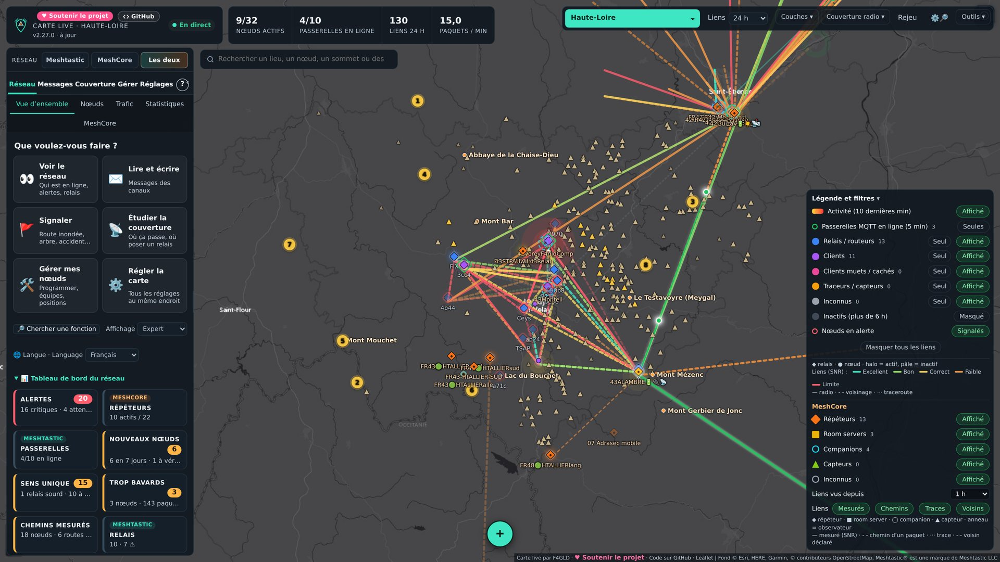

## Fiche d’un relais
Signal, sauts, matériel, rôle, et les actions : couverture, test de portée, programmation à distance, QR des réglages.

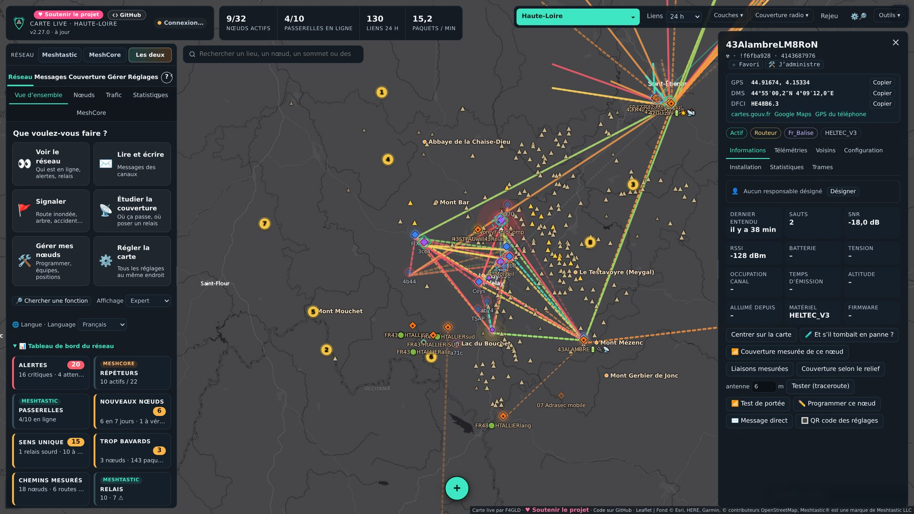

## Télémétrie et santé
Disponibilité, redémarrages, tension jour par jour sur 7 jours et derniers traceroutes.

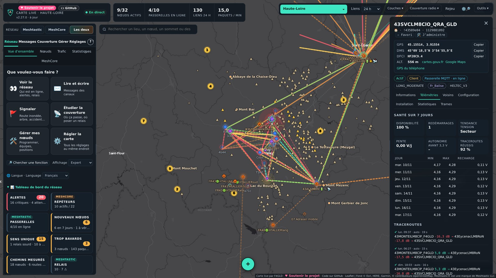

## Couverture d’un point sur le relief
Où un relais placé ici serait entendu, sur le relief réel, avec la surface couverte.

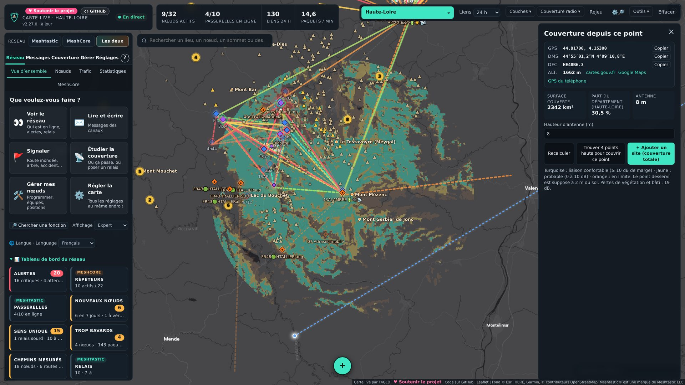

## Couverture de tout le réseau
Zone couverte par les relais détectés et apport de chacun (un relais qui n’ajoute rien saute aux yeux).

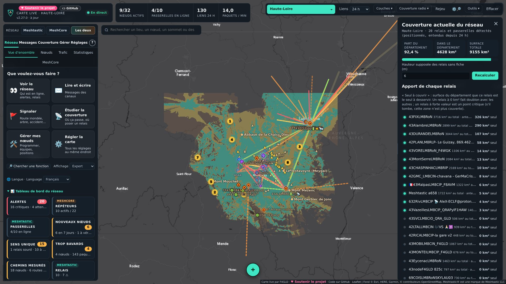

## Profil de relief et bilan de liaison
Ligne de visée, zone de Fresnel, pertes, marge de liaison entre deux points.

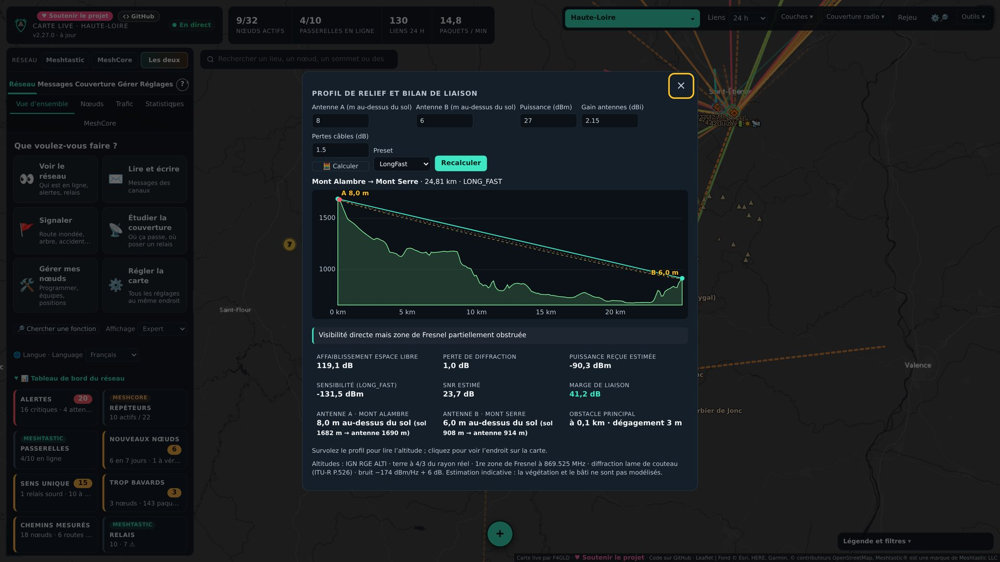

## Choisir où poser un relais
Plan de couverture du département, meilleurs points hauts, et rappel : un point haut n’est pas un site autorisé.

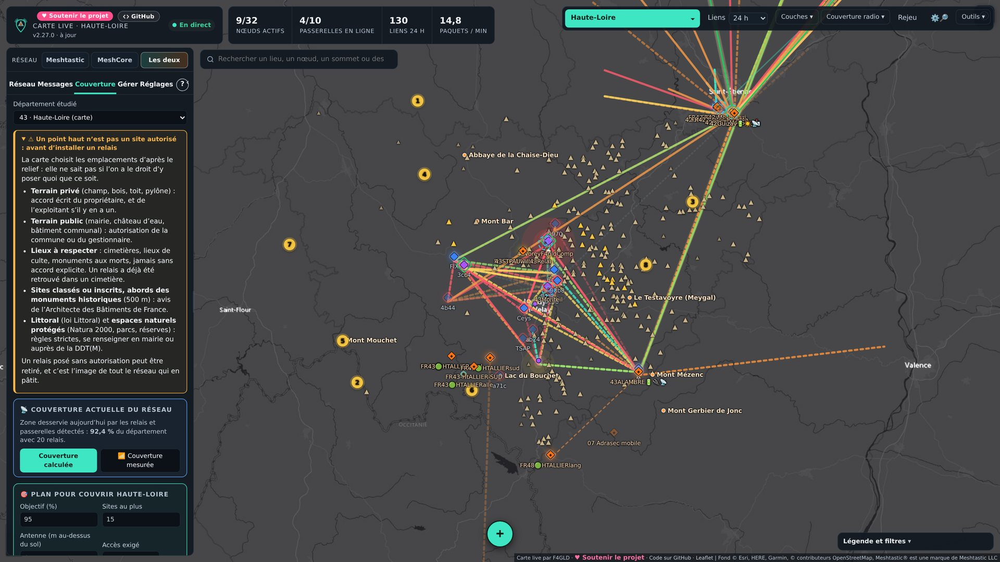

## Liste des nœuds
Meshtastic et MeshCore dans une même liste, par type, avec sauts et dernière écoute.

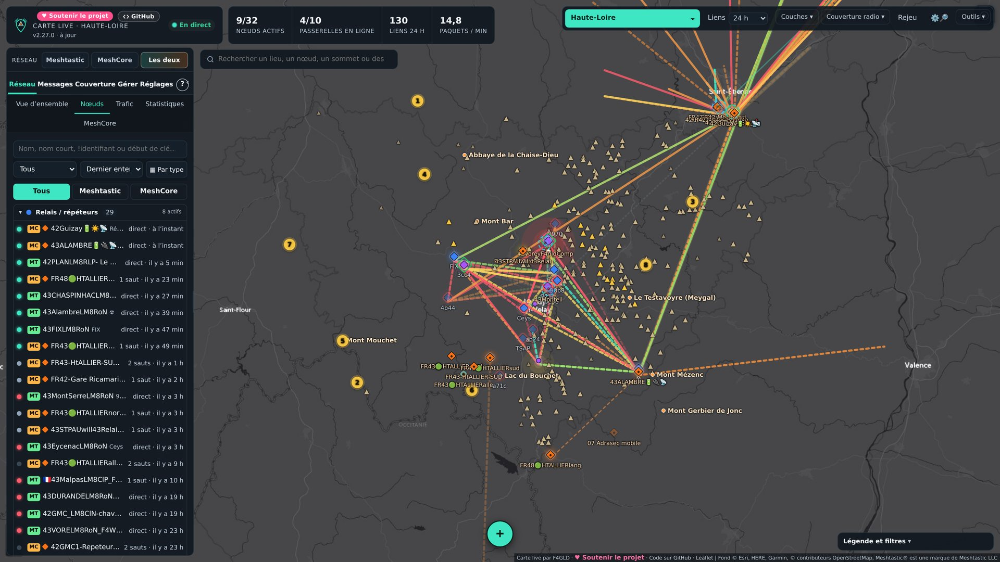

## Trafic radio en direct
Paquets filtrés par type : position, télémétrie, texte, infos nœud, traceroute…

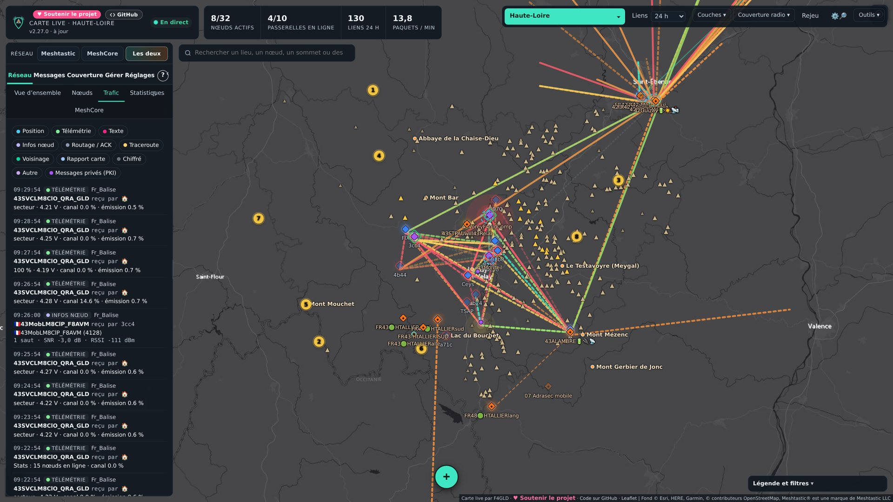

## Statistiques
Occupation du canal, paquets, nœuds trop bavards et réglages à revoir.

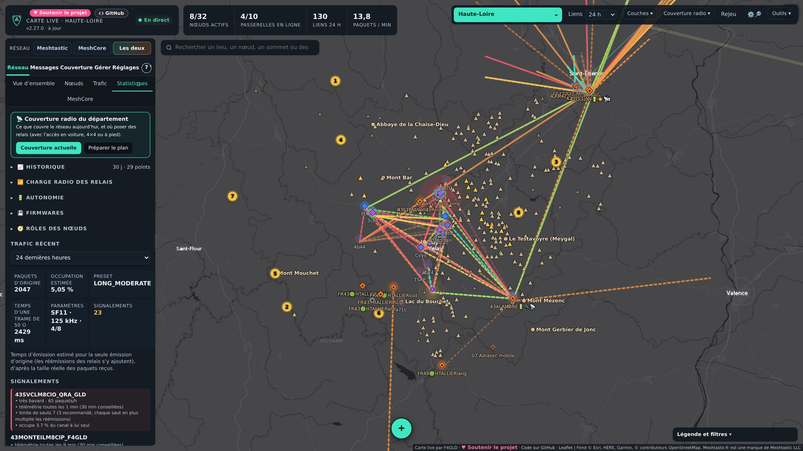

## MeshCore
Répéteurs, room servers, companions, paquets, analyse et messages MeshCore.

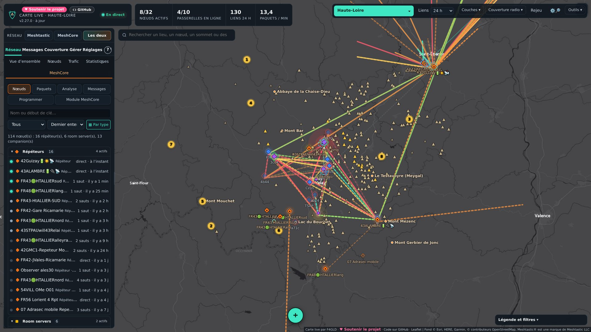

## Administration à distance
Programmer les nœuds Meshtastic par LoRa : clés d’admin, modèles, favoris, firmware, équipes.

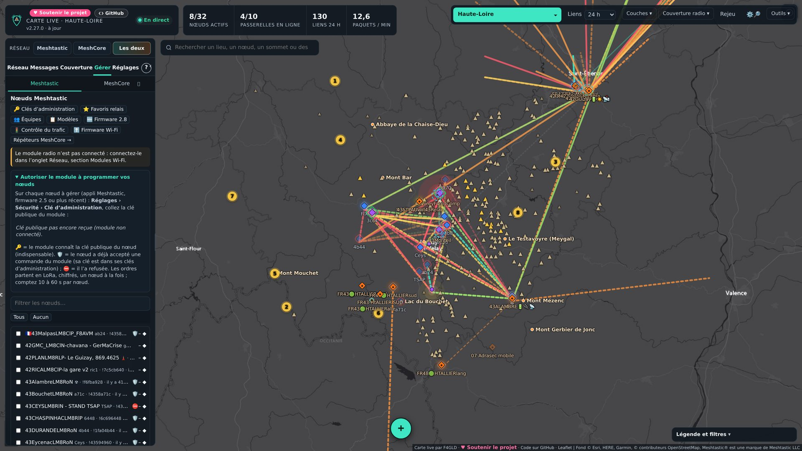

## Vue 3D sur photos aériennes
Le réseau posé sur le relief, liaisons des dernières 24 h, à faire tourner.

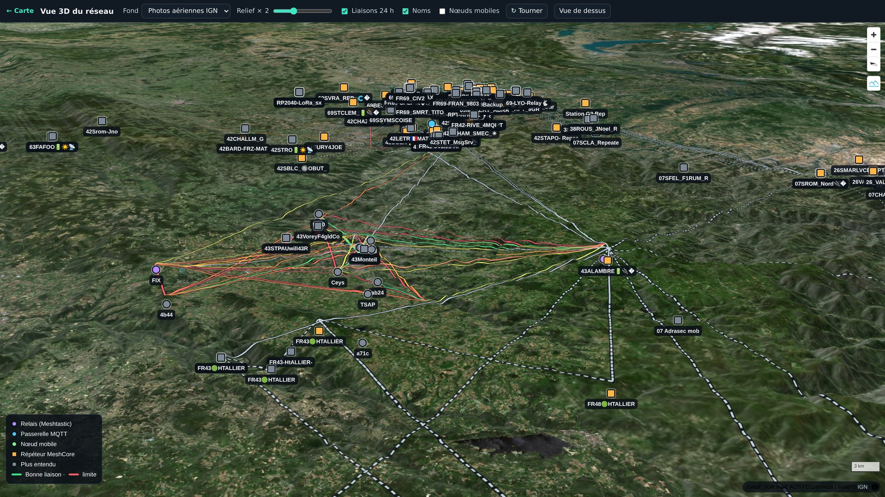

## Vue 3D, fond sombre
Relief exagéré pour mieux voir vallées et crêtes.

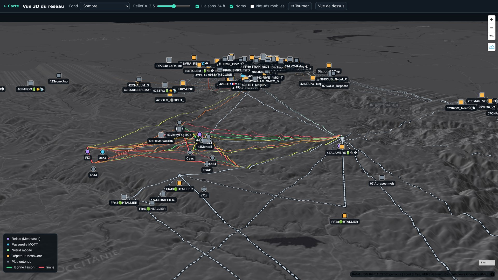

## Sur téléphone
La carte s’utilise aussi au téléphone et s’installe comme une application.

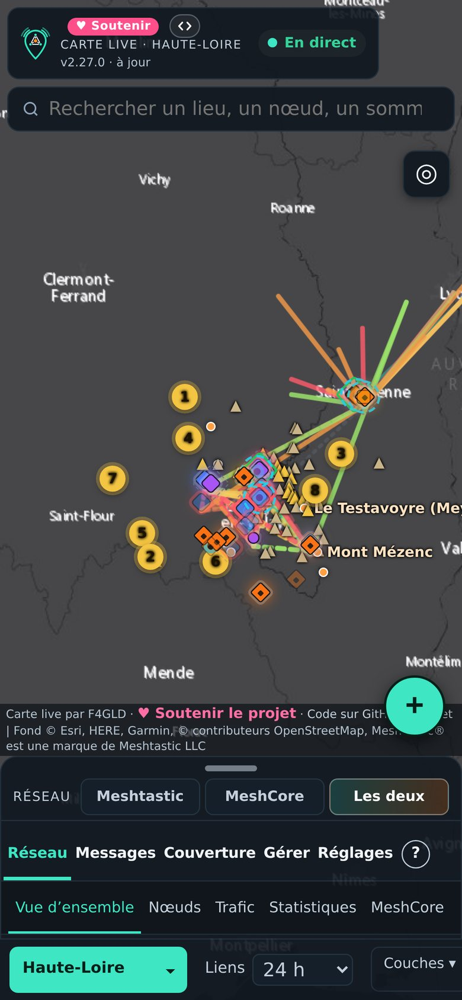

## Topologie du maillage
Graphe des liaisons, distance aux passerelles, points de rupture et liaisons critiques.

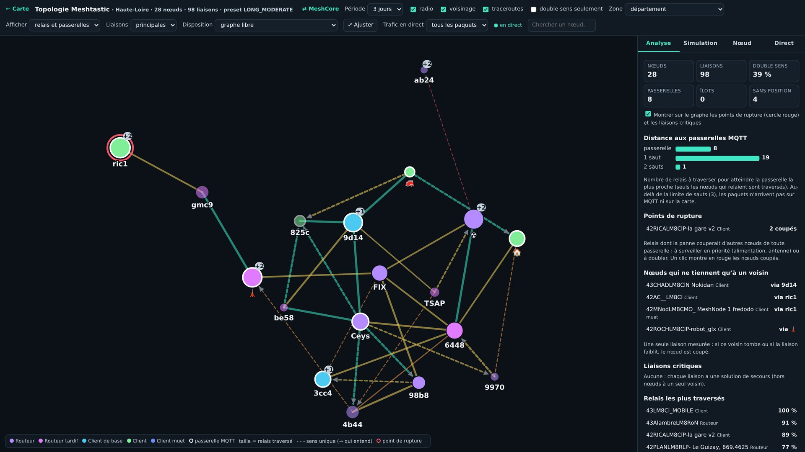

## Registre des relais
Site, autorisation, dernière visite, énergie et firmware de chaque relais, exportable en CSV.

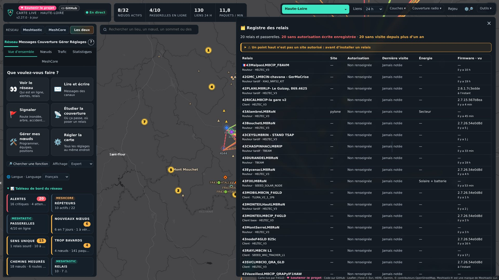
