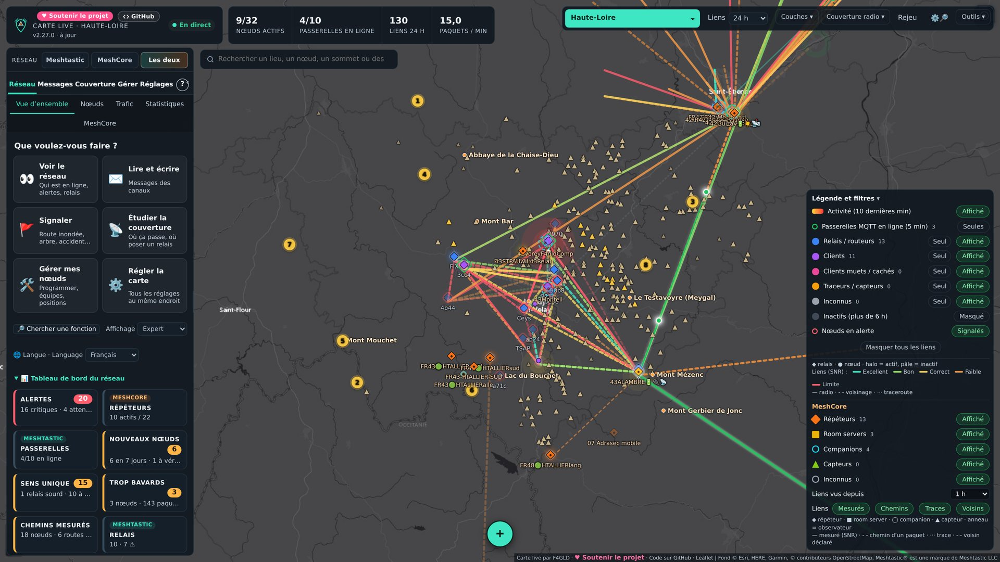
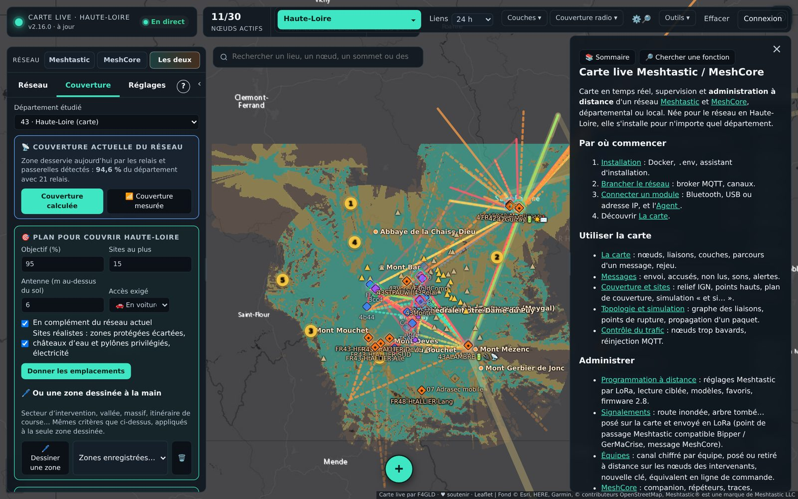

# Carte live Meshtastic / MeshCore

Carte en temps réel, supervision et **administration à distance** d'un réseau [Meshtastic](https://meshtastic.org) et [MeshCore](https://meshcore.co.uk), départemental ou local. Née pour le réseau **Gaulix** en Haute-Loire, elle s'installe pour n'importe quel département.

## Par où commencer
1. [[Installation]] : Docker, `.env`, assistant d'installation.
2. [[Brancher le réseau]] : broker MQTT, canaux.
3. [[Connecter un module]] : Bluetooth, USB ou adresse IP, et l'[[Agent Gaulix]].
4. Découvrir [[La carte]].

## Utiliser la carte
- [[La carte]] : nœuds, liaisons, couches, parcours d'un message, rejeu.
- [[Messages]] : envoi, accusés, non lus, sons, alertes.
- [[Couverture et sites]] : relief IGN, points hauts, plan de couverture, simulation « et si… ».
- [[Topologie et simulation]] : graphe des liaisons, points de rupture, propagation d'un paquet.
- [[Contrôle du trafic]] : nœuds trop bavards, réinjection MQTT.

## Administrer
- [[Programmation à distance]] : réglages Meshtastic par LoRa, lecture ciblée, modèles, favoris, firmware 2.8.
- [[Signalements]] : route inondée, arbre tombé… posé sur la carte et envoyé en LoRa (point de passage Meshtastic compatible Bipper / GerMaCrise, message MeshCore).
- [[Faire grandir le réseau]] : repérer les nœuds réglés sur un autre preset et les inviter, page publique « Rejoindre le réseau » avec QR du canal, règles et relais.
- [[Équipes]] : canal chiffré par équipe, posé ou retiré à distance sur les nœuds des intervenants, nouvelle clé, équivalent en ligne de commande.
- [[MeshCore]] : companion, répéteurs, traces, régions, republication MQTT.
- [[Comptes et sécurité]] : rôles, gestionnaires de secteur, double authentification, journal.
- [[Archive PostgreSQL]] : historique complet, conservation, taille maximale.
- [[Domotique et supervision]] : Home Assistant, Node-RED (y compris envoyer un message LoRa), Prometheus / Grafana pour surveiller les relais, modules Wi-Fi retrouvés par mDNS.
- [[Radioamateurs, APRS, ATAK|Radioamateurs-APRS-ATAK]] : stations LoRa APRS, nœuds en mode licencié, export KML pour ATAK, calculette des pertes de câble, registre des relais.

## Aide

- [[Dépannage]] : les problèmes les plus fréquents et leur solution.
- [Dernière version](https://github.com/sauveteur71/carte-live-meshtastic/releases/latest) · [Signaler un problème](https://github.com/sauveteur71/carte-live-meshtastic/issues)

---
*Carte live créée par F4GLD · [♥ Soutenir le projet](https://www.helloasso.com/associations/radioclub-du-velay/formulaires/2) (Radio-club du Velay)*
