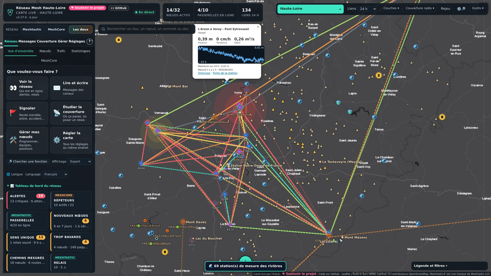

# Rivières et alerte crue

La couche **Rivières** (menu Couches) affiche les stations hydrométriques publiques du secteur : hauteur d'eau, débit et tendance, mis à jour toutes les 10 minutes. Les mesures viennent de l'API publique **Hub'Eau** (eaufrance), les mêmes que celles de Vigicrues. C'est gratuit, sans compte et sans matériel.

## Activer
*Réglages avancés › Rivières (Hub'Eau)* :
- **Afficher les hauteurs d'eau des rivières du secteur** : oui.
- **Alerte de montée rapide** : 20 cm par heure par défaut (« attention »), le double donne une alerte « critique ».
- **Seuils de hauteur par station** : par exemple `K0010020=2,5 ; K0114020=3` (code du site ou de la station = hauteur en mètres). Le code s'affiche dans la fiche de la station.

## Sur la carte
- Chaque station porte sa hauteur et une flèche de tendance (↗ monte, ↘ baisse). Elle passe en orange ou en rouge quand une alerte est en cours.
- Un clic ouvre la fiche : hauteur, tendance, débit, courbe des 24 dernières heures (avec le seuil s'il est réglé), liens vers Vigicrues et la fiche officielle de la station.
- Les alertes apparaissent avec les autres alertes de la carte (tableau de bord, Home Assistant, Prometheus).

## Limites
- Les stations publient toutes les 5 à 60 minutes : une montée très brutale peut apparaître avec un peu de retard.
- La carte ne remplace pas la vigilance crues officielle : suivez toujours Vigicrues et les consignes des autorités.
