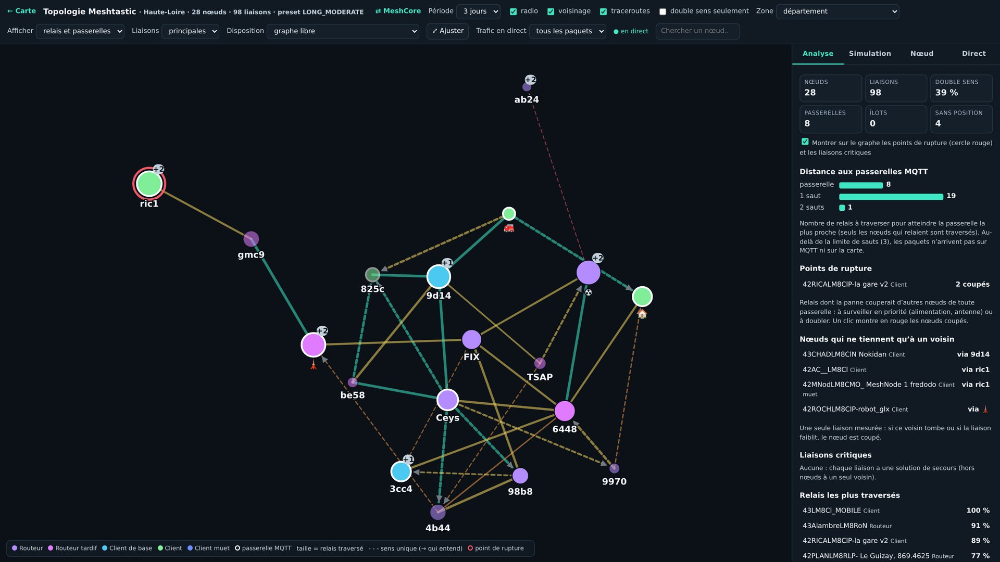

# Topologie et simulation

*Outils › 🕸️ Topologie et simulation* (Meshtastic) et *Topologie et simulation MeshCore*.

## Analyse
- Graphe des liaisons **mesurées** : disposition libre, en anneaux ou géographique ; relais seuls ou tous les nœuds.
- **Points de rupture** : les relais dont la panne couperait des nœuds de toute passerelle.
- **Liaisons critiques**, **relais les plus traversés**, distance aux passerelles face à la limite de sauts, îlots, nœuds sans position.

## Rôles des nœuds

Le rôle décide si un nœud relaie et quand. Un **ROUTER** de trop sur des points bas encombre le canal ; un mobile en **CLIENT_MUTE** soulage le réseau. L'onglet *Statistiques › 🧭 Rôles des nœuds* propose un rôle pour chaque nœud d'après sa position, son relief et son trafic.

## Simulation d'un paquet
- **Meshtastic**, d'après la logique du firmware 2.7 : attente selon le SNR, priorité des ROUTER, annulation par les CLIENT, ROUTER_LATE, sauts gratuits entre favoris, écoute du canal, collisions.
- **MeshCore**, d'après la logique du firmware répéteur : délai aléatoire selon `tx_delay_factor`, `flood.max`, collisions.
- Animée, ou sur 200 tirages, pour comparer preset, limite de sauts, favoris et rôles : part des nœuds atteints, nombre d'émissions, durée.

## Trafic en direct
Les paquets réels sont animés sur le graphe (émetteur → relais → passerelle), avec les axes les plus empruntés et le flux des derniers paquets.
