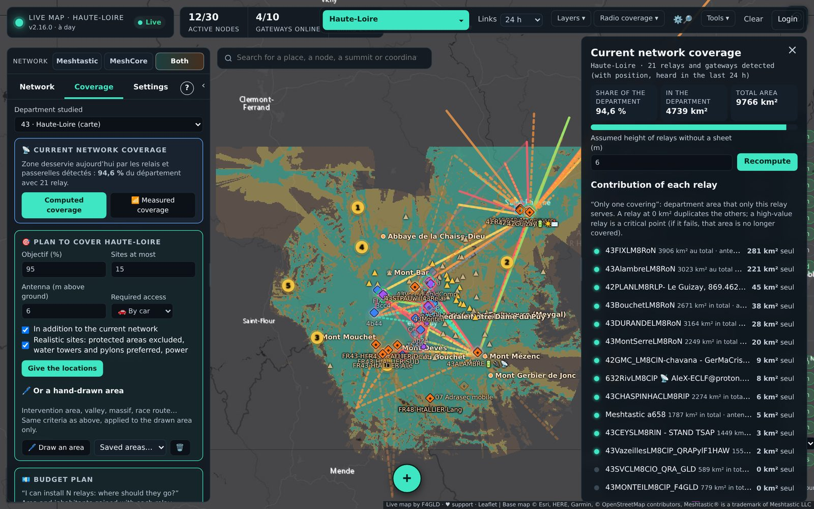

# Coverage and sites

**Coverage** tab and **Radio coverage** menu. Computations use the **IGN RGE ALTI** terrain model (France), calibrated on actually measured links.



- **Current network coverage**: area served by the detected relays, share of the department, what each relay alone covers.
- **Point coverage**: click on the map or on a node; adjustable antenna height. Points near another department automatically use its terrain.
- **Cover one or more points**: sites able to serve a place, or 2 to 5 places with a single relay.
- **Connect two places**: relays needed and where to place them.
- **Plan to cover the department**: goal, number of sites, required access (car, 4×4, on foot); **see the coverage** button on each suggested site.
- **Budget plan**: “I have N relays to install”, area and inhabitants gained.
- **“What if…” simulation**: remove or add relays, towns that would no longer be covered.
- **Profile between two points**: height of each antenna **above ground** (mast drawn on the profile, ground and antenna altitude shown), **road sites** (Department and DIR webcams), **move relays**.
- **Installation sheet** of each relay (antenna, height, gain, cable, power, power source): used by the computations.
- **Measured coverage**: where nodes are actually received from, field surveys.
- **Neighbouring bubbles**: relays from the maps of neighbouring departments (*Tools › Share*).

In the MeshCore view, computations use the French MeshCore radio setting (869.618 MHz, BW 62.5 kHz, SF8, CR8).

## Hand-drawn area
In *Coverage › Plan*, **🖊 Draw an area** studies a sector rather than the whole department: intervention area, valley, massif, race route…
1. Click on the map to place the area's corners (3 at least). “↶ Point” removes the last one. A point that would make the outline cross itself is refused.
2. **➕ Another area** closes the area and starts another one (10 at most): all are studied together.
3. Give a name if you want, then **Finish and study**. A double-click or a click on the first point does the same.

For the area alone, the map gives:
- the share covered today by the network;
- the high points to equip, in order, with each one's area gain;
- for each one, **other possible locations** (1a, 1b, 1c) with a similar contribution, if the suggested site cannot be used;
- the final coverage (blue: already covered, turquoise: added, red: not covered).

**Antenna (m above ground)**: antenna height of the suggested sites for the drawn area (6 m by default, from 1 to 60 m); it is recalled in the result. The department plan uses the height set by the high point ranking (6 m), shown in its result.

The criteria are those of the department plan: goal, number of sites, access (changeable in the result: car, 4×4, on foot, all), current network, realistic sites. Candidate high points are those of the area and within 10 km around it. The area must stay inside the loaded terrain (the department and its surroundings). Areas are kept in this browser (*Saved areas…*), and the sites' GPX can be downloaded.

## Whole of France: terrain of other departments
By default, coverage computations cover the map's department, whose terrain is downloaded at installation. To compute elsewhere:

- **Logged-in accounts**: *Coverage › Department studied*; the chosen department's terrain is downloaded at the first computation (a few minutes), then kept on the server.
- **Public map**: the administrator chooses in *Manage › Settings › Public map and terrain* between “map department only” (light, default) and “all departments of France”.

### Download and install the whole of France
*Tools › 🗺️ Whole of France › ⬇ Download and install the whole of France* (also in *Manage › Settings › Public map and terrain*) puts the terrain of all departments on the server, so every computation is immediate. **Nothing to download by hand**:

1. the map first downloads the **“France terrain” package** published on GitHub (`relief-france` release, ≈ 110 MB) and installs it: a few minutes;
2. it then completes, department by department, whatever is missing (IGN, OpenStreetMap);
3. progress is shown (current department, time left); preparation continues with the page closed, resumes by itself after a restart, and stops in one click. Departments already ready are skipped.

Once everything is installed, the public map switches **by itself** to “all departments”: any visitor can then compute coverage anywhere in France.

Allow ≈ 250 MB on disk. Without the package (network blocking GitHub…), full preparation takes several hours.

Other package address (mirror, local network): `RELIEF_FRANCE_URL=https://…/relief-france.tar.gz` in the `.env`.

Installation without internet: copy `relief-france.tar.gz` into the data volume, then
```bash
docker compose exec carte-live tar -xzf /data/relief-france.tar.gz -C /data --skip-old-files
```

### Updating the package (maintainer)
About once a year (new roads, summits, pylons in OpenStreetMap):
1. on a map that has prepared everything: **📦 Build the “France terrain” package** (same screen);
2. on GitHub, *Releases › relief-france › Edit*: delete the old `relief-france.tar.gz`, attach the new one in the **“Attach binaries”** box (the text area refuses more than 25 MB), keep the *pre-release* box ticked.

Sources: IGN RGE ALTI terrain (Licence Ouverte Etalab 2.0); high points, access roads and sites © OpenStreetMap contributors (ODbL).
