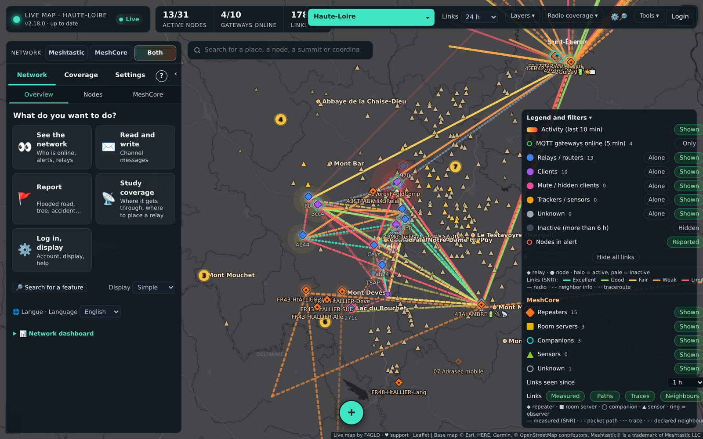
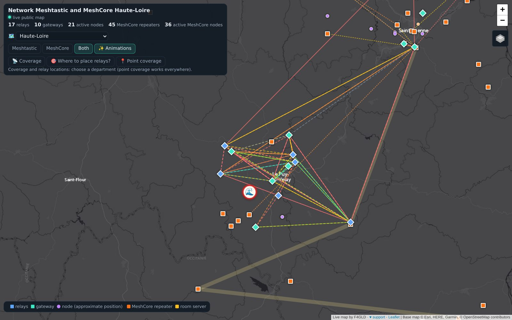
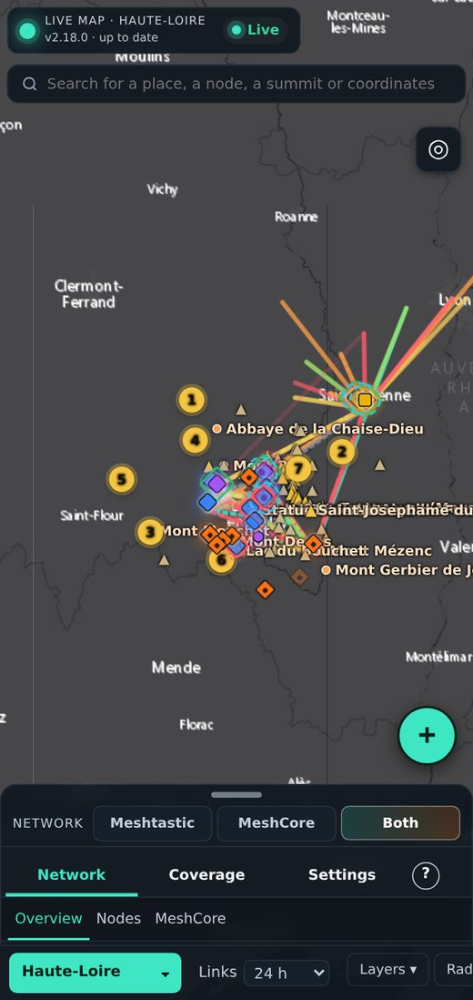
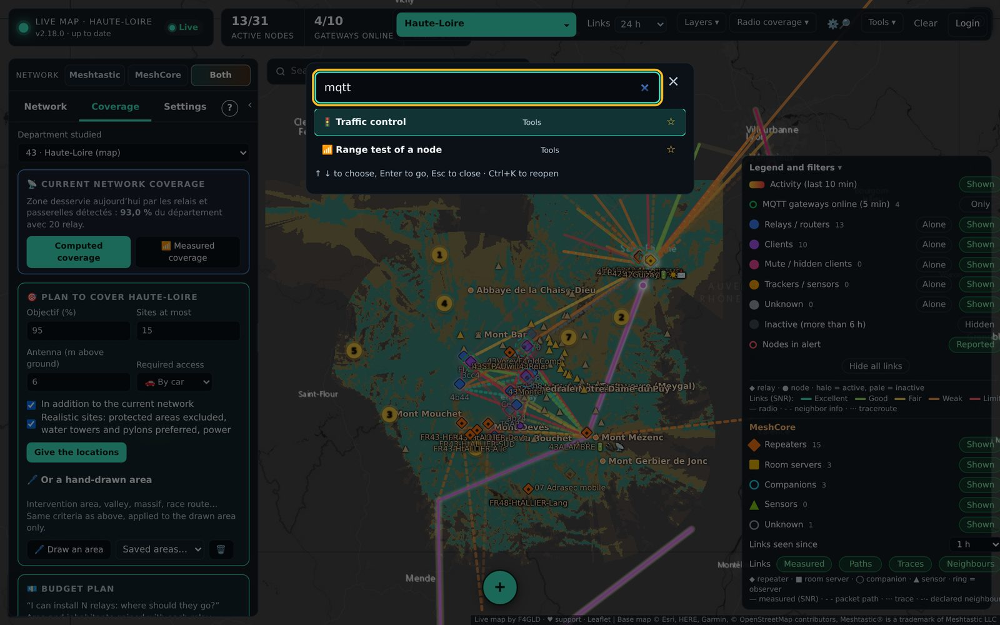

# The map

## Finding your way
- **5 sections** at the top of the panel: **Network** (overview, nodes, traffic, statistics, MeshCore), **Messages** (Meshtastic and MeshCore), **Coverage**, **Manage** (Meshtastic and MeshCore programming, teams, keys, firmware) and **Settings**. Sub-sections show just below.
- **“What do you want to do?” home**: large tiles (see the network, read and write, report, study coverage, manage my nodes, set up the map). The full dashboard is folded below.
- **Display level** (home, or Settings): **Simple** shows the essentials, **Operator** adds advanced coverage, traffic and field tools, **Expert** shows everything. By default: simple for a visitor or member, operator for a manager, expert for an administrator. Permissions don't change: only the display is lighter.
- **Language**: *Settings › Display › 🌐 Language* (or at the bottom of the home screen): French or English. By default it follows the browser's language.
- **Settings**: everything is in one place (display, account, nodes and networks, map, MQTT, accounts, backups, update, whole of France, bridge, teams).
- **A single search**: the field above the map finds a place, a node, coordinates… and also a **feature** or a setting (“mqtt”, “teams”, “update”). ⚙️🔎 or Ctrl+K opens the feature search; the ☆ star of a result adds it to **⭐ My shortcuts** on the home screen, and recent features are offered first.
- **＋ button** on the map: tap ＋ then a point on the map to report an event, see the coverage from this point, share it or draw a profile (no right-click needed, handy on a phone).
- **“?”** to the right of the sections: help for the current screen opens in the map (pages of this wiki). **Guided tour** on the first visit, to take again from Settings.
- **Comfort and accessibility**: confirmations and messages inside the interface (no more browser pop-ups), **Large text** option, light theme, keyboard navigation (Tab, Enter, Esc), labels for screen readers, larger buttons on touch screens.

## Nodes and networks
- **Meshtastic / MeshCore / Both** selector at the top of the panel. When switching network, the other network's traces are cleared.
- **Legend and filters**: relays, clients, mute clients, trackers, unknown, inactive, MQTT gateways online, nodes in alert.
- Area shown (menu at the top): the department, the department and its neighbours, a **French region** or the whole of France. The choice is kept between visits. You only see what the map receives: your MQTT broker's reach and, for MeshCore, the “Packets kept” setting (department, neighbours or national).
- Click on a node: **detailed sheet** (info, telemetry, neighbours, “heard by”, frames, inferred configuration, range test) and a **Statistics** tab: activity hour by hour over 1 to 30 days, packet types, SNR received directly, hop count to arrive, receivers that hear it most.

## Links
- **Measured**: SNR received by gateways, neighbor info (NeighborInfo), traceroutes. Colour by SNR, adjustable period (*Links 24 h*).
- **One-way links** and **deaf relays** (*Network › Links*): a relay that transmits well but hears badly, with the estimated gap in dB.
- **Measured paths**: automatic traceroutes, with the SNR of each hop.

## Live traffic
Each packet is animated: a comet travels the route hop by hop, the links used light up and the paths most used in the last 10 min are underlined. When intermediate relays are not known, the most probable route is drawn dotted.

## A message's route
In *Messages*, clicking a message's origin (📡 / 🌐) shows its **route**:
- other links and paths are **hidden** to see only the route;
- thick line outlined in black, direction **arrow** on each hop, **SNR** of the last hop to each receiver;
- the sheet lists each reception (gateway, hops, SNR, last relay);
- **✕ Clear the route** brings the links back.

## Alerts, maintenance, history
- **Alerts**: silent node, low battery, saturated channel, gateway offline.
- **Statistics › Maintenance**: relays' radio load, runtime, firmware, role advice.
- **History** over more than a year, **replay** of the last 24 hours, **weekly report** (*Tools*).
- **Map health** (*Network*): processor, memory, disk, database, MQTT.

## How to reach it and person in charge of a node
Node card, **Neighbours** tab, **How to reach it** section: through which station of the map to reach it (linked module, listening modules, then MQTT gateways that heard it) and the state of the link: *direct, both ways proven*, *direct, return path not proven*, *N hops* or *out of range*. Hearing a node does not prove it hears us: the return path is proven when it lists us as a neighbour, a traceroute comes back or a link is measured the other way. An MQTT gateway only listens.

Node card, **Information** tab: **👤 Person in charge**, the person responsible for the node (a map account or a free name, with a contact). Visible to signed-in members only, the contact to managers only; editable by whoever can manage the node. An administrator can at the same time give the account the right to configure this node (it joins their sector). The person in charge is also shown in each team's member list.

## Field mode and app
*Tools › Field mode*: GPS surveys with radio measurement and photo, even without network. The map installs like an app (“Add to home screen”, HTTPS required).

## Public page

A public page (no messages or exact positions of private individuals) can be shared: *Tools › Share*. It is for viewing the network, without being able to change anything.
- Each visitor chooses the **area** shown: the map's department, with its neighbours, a region, any department or the whole of France. Nodes, links, figures and animations follow. By default, coverage computations (coverage, where to place relays, point coverage) stay on the map's department: elsewhere, the public map is a light network map. The administrator can open them to **all departments** (*Manage › Settings › Public map and terrain*): a department's terrain is then loaded at the first computation, or in advance with **Tools › 🗺️ Whole of France › ⬇ Download and install** (can be stopped at any time, ≈ 250 MB on disk). Preparation first installs the “France terrain” package published on GitHub (`relief-france` release, ≈ 110 MB), then completes department by department. **📦 Build the package** produces this file from a map that has prepared everything. Sources: IGN RGE ALTI terrain (Licence Ouverte Etalab), high points, access and sites © OpenStreetMap contributors (ODbL).
- The title follows the chosen network and area.
- **🧭 Try the full map (demo)** opens, for everyone and without an account, the full map as a **demo**, on the same view: every tab and screen (Messages, Manage, MeshCore, Settings…), with the real messages of **public channels** only (default key, MeshCore Public and “#” channels; never private channels or direct messages). Passwords, channel keys, addresses, contacts and accounts are never sent; accounts, log, backups and update stay private. Nothing is saved or sent by radio: every attempt shows “Demo: nothing is saved or sent”. No sign-in or sign-up from the demo. Direct link: `/?consultation`.
- The link to the full map (administration) only appears to logged-in administrators.

## Favorites and “My nodes”
In a node's sheet, Meshtastic or MeshCore (logged-in account):
- **☆ Favorite**: the node moves to the top of the lists, with a ⭐;
- **🛠 I administer**: the node joins the **My nodes** group.

Nodes you can program are included automatically:
- for an administrator, Meshtastic nodes accepting the map's node and MeshCore repeaters whose password is remembered;
- for a manager, the nodes of their area.

Clicking “🛠 My nodes ✓” removes one, and it no longer comes back automatically.

The **Network** panel has a **My nodes** section: administered first (silent ones first), then favorites, with status, battery and last contact. The *Nodes* lists (Meshtastic and MeshCore) have an **All / ⭐ Favorites / 🛠 My nodes** choice. Choices belong to each account and follow from one device to another.

**“Silent node” alert**: in the *My nodes* tile, tick “🔔 Notify me when one of my nodes has been silent for…” and choose the delay (1 to 24 h). With the map open (PC or phone), a notification and a box are then shown, once per silence. If the node comes back then goes silent again, you are notified again.

## Frozen GPS
The map flags in the alerts a node that keeps sending its position while the GPS fix it announces is more than 30 min old: GPS without signal, unplugged antenna or broken module. A fixed-position relay that has never moved is not concerned.

## Rain radar
*Layers ▾ › Rain radar*: the latest radar image (RainViewer, free), updated every 10 minutes, over the map. Handy to follow a storm approaching relays or teams.

## DFCI grid
The French firefighters' DFCI grid (forests, rescue) is built into the map:
- **Layers ▾ › DFCI grid**: the grid is shown according to zoom (100 km squares, 20 km squares, 2 km squares, then the 5 zones of 1 km when zoomed in), with each square's code.
- **Coordinates**: wherever the map gives coordinates (right-click, node sheet, search), the point's **DFCI code** is shown with a *Copy* button (e.g. `HF20B2.1`).
- **Search**: type a code (`HF20B2`, `HF20B2.1` or just `HF20`) in the search bar: the map centres on it and draws the square.
- **Reports**: the message sent over LoRa and the log book also give the DFCI code.

Reading the code: 2 letters (100 km square), 2 even digits (20 km square), a letter and a digit (2 km square), then `.1` to `.5` (zone: 1 north-west, 2 north-east, 3 south-east, 4 south-west, 5 centre). The computation follows the official grid (Lambert II étendu) and was checked against the grid published on data.gouv.fr.

## Right-click on a node
A right-click (or long press on a phone) on a node, in a list or on the map, opens a menu:
- open the sheet, centre the map;
- ☆ add to favorites, 🛠 add to “My nodes” (or remove them);
- ✉️ direct message, 📶 listen live (Meshtastic), 📡 coverage from this node;
- 📍 share its position in a message;
- 📍 **request its position** (manager, Meshtastic): the node sends back its position, the answer shows at the bottom of the screen;
- 📋 copy the ID;
- 🧭 path from the companion (MeshCore, member): see [[MeshCore]];
- 🗑 **delete this node** (administrator): for a node that no longer exists. It disappears from the map and the database (positions, telemetry, links); a MeshCore node is also removed from the companion's contacts. If it still transmits, it will reappear at its next advert.

Right-clicking elsewhere on the map keeps its usual menu: coverage, profile, sharing the point…

## Node list
The Meshtastic list, like the MeshCore one, can be sorted **by type** (▦ By type): relays, clients, mute clients, trackers, unknown, each group folding in one click. The state is kept in the browser.

## On phones and tablets

- **Drawer panel** (phone, tablet upright): handle to pull or tap, three heights (tabs only, half, full). In landscape, the panel moves to the side.
- **Node sheet as a drawer**: tap the handle to enlarge it, swipe it down to close it.
- **◎ My position** (top right of the map): blue dot and precision, followed while the button is on (the map must be on HTTPS).
- **Long press on the map**: coverage from this point, connect, profile, share the point, copy the coordinates.
- Toolbar on one line that scrolls with the finger, buttons and menus enlarged for fingers.
- Node names shown only when zooming in; at low zoom, nearby nodes (except relays and gateways) are **grouped** into a “12” bubble that a tap enlarges.
- **☀️ Light theme** (Tools › Display): light high-contrast interface for full sunlight.
- **📲 Install the app** (Tools, when the browser offers it): icon on the home screen, full screen, last known map shown without network (nodes, links, MeshCore).
- **Saving**: animations off by default on mobile and in data-saving mode; live feed paused after 2 min in the background, resumed on return; lines drawn on canvas.

## Searching for a setting

The **⚙️🔎** button at the top (or **Ctrl+K**) opens a search through the map's settings and features: type “MQTT”, “password”, “IATA”, “teams”, “firmware”… then Enter. The map opens the right tab or window and highlights the setting. Only the settings allowed for your account are offered.
